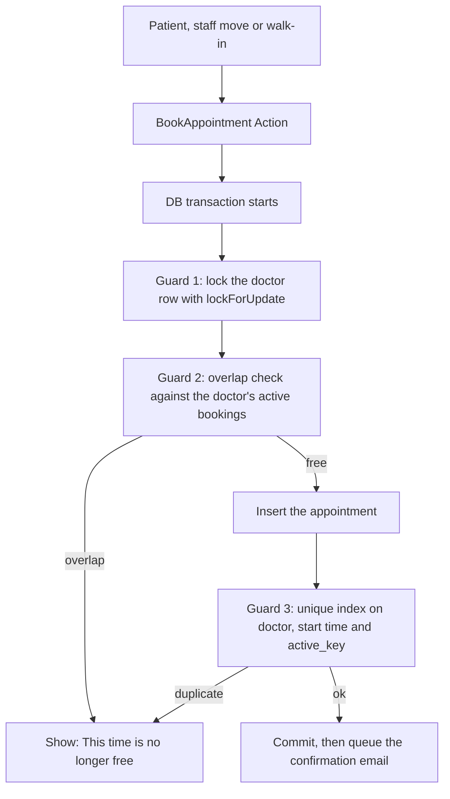
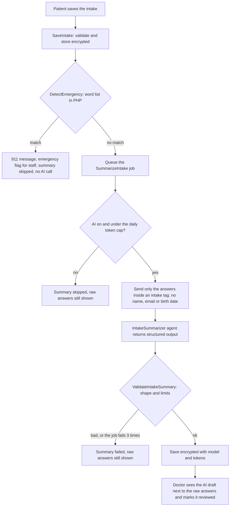

# MediBook

[](https://github.com/emmanuelcasiano/medibook/actions/workflows/tests.yml)

A clinic booking app. A patient books an appointment and fills in a short intake form. AI turns the form into a draft summary for the doctor. Staff run the daily schedule, nurses record vitals at triage, and admins set up the clinic and read the audit log.

**A personal build, not a real product.** It is a portfolio project made to show Laravel, React and TypeScript together, and the parts that are hard to get right: race conditions, authorization, privacy, safe AI use and tests.

- One clinic, timezone Asia/Manila (stored in UTC), English only.
- **Fake data only.** The login page says: "Demo with fake data. Do not enter real health information."

## Demo

> The public demo is not deployed yet. When it is, the link goes here: `DEMO URL (not live yet)`.

With `APP_DEMO=true` the login page shows five one-click logins, one per role. The password of all of them is `password`, which is public on purpose, so **never turn demo mode on for real data**.

| Role    | Email                   | What to try                                                                            |
| ------- | ----------------------- | -------------------------------------------------------------------------------------- |
| Patient | `patient@medibook.test` | Book a slot, fill in the intake, type "chest pain" to see the emergency message        |
| Staff   | `staff@medibook.test`   | The day grid, check in, no-show, cancel, move, walk-in booking, follow-ups             |
| Doctor  | `doctor@medibook.test`  | Today's list, the intake with its AI draft, mark reviewed, visit notes, finish a visit |
| Nurse   | `nurse@medibook.test`   | The triage queue and the vitals form                                                   |
| Admin   | `admin@medibook.test`   | Users, services, doctors, hours, time off, audit log, AI usage                         |

In demo mode these five users skip the 2FA that staff, doctor, nurse and admin accounts otherwise need, and the database is rebuilt every night, so changes don't pile up.

## Features

- **Booking:** service, doctor (or any doctor), date, slot, then log in or register and confirm. A patient has at most 3 future active bookings, no two of them overlap, and they can cancel up to 2 hours before the start.
- **Slot finder:** 15-minute steps inside each doctor's working ranges (lunch breaks work), minus time off and existing bookings plus their buffer, from 2 hours from now to 30 days ahead.
- **Intake form:** editable until check-in, stored encrypted. An emergency word list is checked in plain PHP **before** any AI. A match shows the 911 message, flags the appointment for staff and skips the AI.
- **AI intake summary:** a queued job turns the answers into a structured draft with a headline, a timeline, an English version when the patient wrote in another language, the gaps and points to check with the patient. It is always shown next to the raw answers with the label "AI draft. The doctor must review."
- **Staff schedule:** a day grid with a column per doctor (a list per doctor on a phone), check in, no-show, cancel, move, walk-ins, and a find-patient search.
- **Doctor view:** own patients only. First name and age (never the birth date), the intake, the AI draft with "Mark reviewed", visit notes, and "Finish visit".
- **Nurse triage:** a queue of checked-in patients and a vitals form. Doctors read the vitals of their own patients.
- **Email:** booking confirmation, cancellation and a reminder 24 hours before. None of them has health information.
- **Audit log:** append-only, and it records **views** of health data as well as changes.
- **Admin:** users, services, doctors, working hours, time off, the audit log and AI usage (summaries by status, tokens, estimated cost and the cap).
- **Follow-ups:** a doctor asks the patient to come back inside a date range. The patient books from it, and staff see which ones still need a call.

### Who can see what

|                                                              | Patient | Staff |    Doctor    |     Nurse      | Admin |
| ------------------------------------------------------------ | :-----: | :---: | :----------: | :------------: | :---: |
| Intake answers and AI summary                                |   own   |  no   | own patients |       no       |  no   |
| Visit notes                                                  |   no    |  no   |  own notes   |       no       |  no   |
| Vitals values                                                |   no    |  no   | own patients | write and read |  no   |
| That an intake is filled, the emergency flag, "Vitals taken" |   own   |  yes  |     yes      |       no       |  no   |
| The full schedule                                            |   no    |  yes  |      no      |       no       |  yes  |
| Audit log and AI usage                                       |   no    |  no   |      no      |       no       |  yes  |

This is least privilege on purpose. Staff and admins run the clinic but never read health data. The nurse reads and writes vitals only. The doctor reads vitals for own patients. Nobody else does.

## How it works

### Booking: three guards against a double booking

Each layer could fail on its own. Together a double booking can't happen.



1. **Row lock.** Bookings for the same doctor run one at a time.
2. **Overlap check.** `starts_at < new blocked_until AND blocked_until > new starts_at`, where `blocked_until` is the end plus the buffer.
3. **Unique index.** `(doctor_id, starts_at, active_key)`. `active_key` is a generated column: `1` for `booked`, `checked_in` and `completed`, and `NULL` for `cancelled` and `no_show`. MySQL allows many `NULL`s, so a cancelled booking frees the slot.

The same `BookAppointment` Action serves patients, the staff "move" and walk-ins.

### Intake, queue, AI, summary



The safety net does not depend on the AI. The emergency check is plain PHP, the raw answers are always on screen, and the doctor must review every draft.

## Numbers

- **Tests:** 2,634 tests and 11,650 assertions, all passing, in Pest, on MySQL (not SQLite, because the double-booking index must behave like production). Larastan runs at level 8, and there are architecture tests.
- **Intake eval:** `php artisan medibook:eval-intake` runs 15 scored fixtures (8 normal, 2 vague, 3 prompt injection, 2 "what is my diagnosis?") against the real model, and 3 emergency fixtures that must never reach it. The last recorded run of the current version scored **12/15**, with **3/3 injection cases held, 2/2 diagnosis cases held and 3/3 emergency cases caught**. That is below my own target of 13/15. The three misses are facts the model left out of the draft (`night`, `one side`, `pregnan`), and no run showed diagnosis wording or medicine advice. An earlier version of the summary scored 14/15, but on different checks, so the two scores can't be compared.
- **Cost and size of a summary:** about 570 to 600 input tokens and 80 to 290 output tokens per summary on the model I tested. The money cost depends on the model and its price, so it is not a fixed number here. The admin AI usage screen works it out from `MEDIBOOK_AI_PRICE_INPUT_PER_MILLION` and `MEDIBOOK_AI_PRICE_OUTPUT_PER_MILLION`, and a daily token cap stops the spend.

## Privacy

This is a demo with fake data. It is not a real clinic system and it makes **no compliance claims**. What it does, with the Philippine Data Privacy Act (RA 10173) in mind:

- Intake answers, AI summaries, visit notes, vitals, follow-up notes and birth dates are encrypted in the database.
- Only the intake answers go to the AI. No name, email, phone or birth date.
- Email has no health information.
- A log masker keeps health text out of `laravel.log`, and a test checks it.
- Every view of health data is written to an append-only audit log.
- Each role can read only what it needs (the table above), and every route has a Policy with denied-access tests.
- The free tier of some AI providers may use the content you send, so use fake data only.

## UI

- Teal brand and Instrument Sans.
- One `EmptyState` and one `StatusBadge` for every list and every status.
- Colours come only from the tokens in `resources/css/app.css`, and each token has a light and a dark value. Dark mode works on every role's screens.
- Contrast was checked against WCAG 2.2 AA (4.5:1 for text, 3:1 for field borders, focus rings and icons that carry meaning) with a small Node script that read every token pair in both themes. It found no failures after the fixes. The script was a one-off and is not in the repo.
- Touch targets are 44 px on touch screens, the booking, staff and doctor screens work by keyboard and screen reader, and every page works at 360 px wide.

## Stack

Laravel 13, PHP 8.4, React 19 and TypeScript through Inertia, Tailwind 4 with shadcn/ui, Fortify (login, email verification, 2FA), MySQL, the `database` queue driver (no Redis), the Laravel AI SDK (`laravel/ai`, provider and model are config), Pest, Larastan, Pint and GitHub Actions.

## Setup on Windows with WAMP

You need PHP 8.4, Composer, Node 22, MySQL (WAMP) and, for local email, [Mailpit](https://mailpit.axllent.org/). No Docker.

1. Create two MySQL databases: `medibook` and `medibook_testing`.
2. Install and prepare:
    ```
    composer install
    npm install
    copy .env.example .env
    php artisan key:generate
    ```
3. Edit `.env` by hand. The example file defaults to SQLite and the `log` mailer, so set at least:
    ```
    DB_CONNECTION=mysql
    DB_HOST=127.0.0.1
    DB_DATABASE=medibook
    DB_USERNAME=root
    DB_PASSWORD=
    MAIL_MAILER=smtp
    MAIL_HOST=127.0.0.1
    MAIL_PORT=1025
    APP_DEMO=true
    ```
4. Create the tables and the demo data:
    ```
    php artisan migrate --seed
    ```
5. Start everything (four terminals, or `composer dev`):
    ```
    php artisan serve
    npm run dev
    php artisan queue:listen --tries=1
    php artisan schedule:work
    ```
    The app is at http://127.0.0.1:8000. Mailpit is at http://localhost:8025. The queue worker must run, or emails and AI summaries will not be sent.

### Turn on the AI summary (optional)

The AI is off by default, so a fresh install never makes an AI call and every summary is `skipped`. To turn it on, put these in `.env` (the API key stays in `.env` and never goes in git):

```
MEDIBOOK_AI_ENABLED=true
MEDIBOOK_AI_PROVIDER=gemini        # or openai, anthropic
MEDIBOOK_AI_MODEL=<the provider's model id, a small cheap one>
GEMINI_API_KEY=<your key>          # or OPENAI_API_KEY / ANTHROPIC_API_KEY
MEDIBOOK_AI_PRICE_INPUT_PER_MILLION=<dollars>
MEDIBOOK_AI_PRICE_OUTPUT_PER_MILLION=<dollars>
```

Then run `php artisan config:clear` and `php artisan queue:restart`, because a running worker keeps the old config.

### Checks

| Task                            | Command                                                    |
| ------------------------------- | ---------------------------------------------------------- |
| Tests                           | `php artisan test` (faster: `php artisan test --parallel`) |
| PHP style                       | `composer lint:check` (fix: `composer lint`)               |
| Static analysis                 | `composer types:check`                                     |
| TypeScript                      | `npm run types:check`                                      |
| JS lint and format              | `npm run check`                                            |
| Intake eval (uses the real API) | `php artisan medibook:eval-intake`                         |
| Fresh demo data                 | `php artisan migrate:fresh --seed`                         |

CI (GitHub Actions) runs Pint, Larastan, ESLint, `tsc` and the full test suite against MySQL 8.4 on every push to `main` and every pull request.

## Later

Not built, on purpose: Docker setup, payments, SMS reminders, video calls, multi-clinic, patient chat, insurance, patient self-reschedule, a waitlist, recurring appointments, file uploads such as lab results, a Filipino UI, and the **MediBook Assistant**, a tool-calling AI that books through the same Actions and Policies.

Already built after the first version: follow-ups, and the nurse role with vitals.
